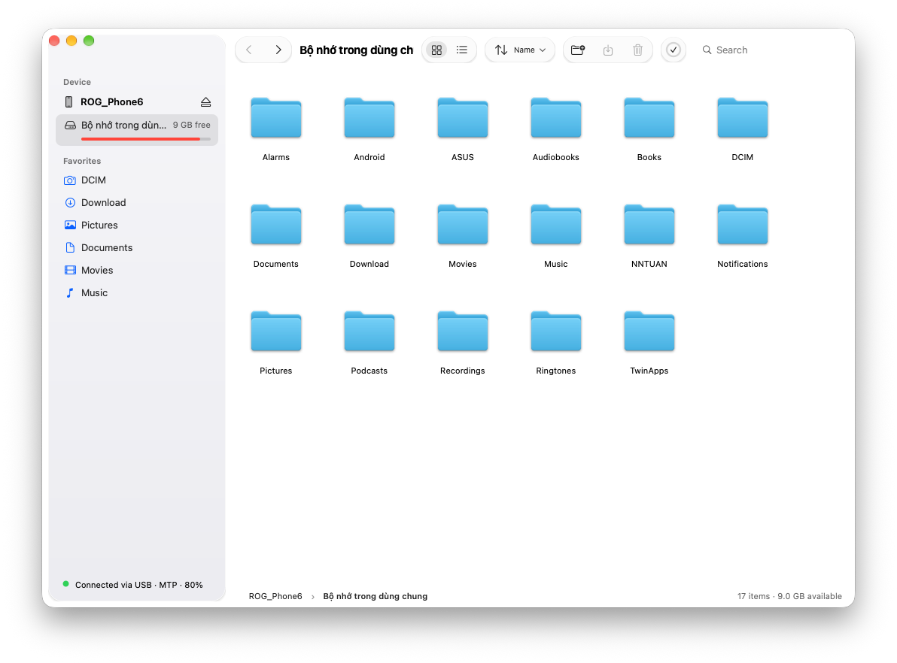
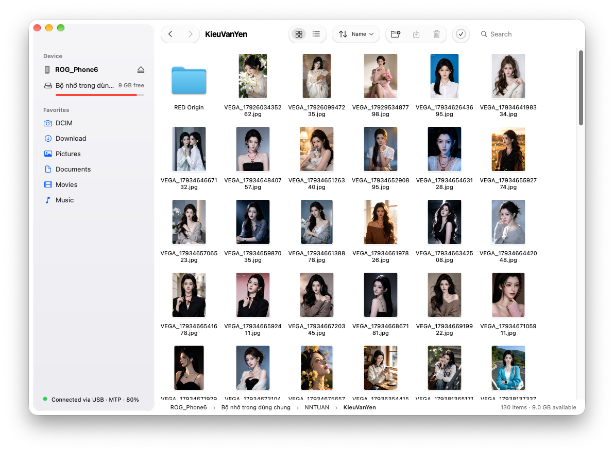

<div align="center">



# MacDroid

**Browse and manage the files on your Android phone from your Mac, the way you use Finder.**

[](#requirements)
[](https://www.qt.io)
[](#tech-stack)
[](CHANGELOG.md)
[](#localisation)

[Features](#features) · [Install](#install) · [Build from source](#build-from-source) · [Usage](#usage) · [Troubleshooting](#troubleshooting) · [Dependencies](#dependencies)

</div>

---

MacDroid is a native-looking macOS app that talks to Android phones over USB using **MTP** (Media Transfer Protocol). It lives in the menu bar, notices when a phone is plugged in, and opens a Finder-like browser with the macOS 26 *Liquid Glass* look: sidebar, list and icon views, thumbnails, drag and drop, copy and paste with Finder, and a transfers panel.

<p align="center">
  
</p>

<p align="center">
  
  <br>
  <sub>Icon view with thumbnails for photos, videos and PDFs, generated on demand and cached on disk.</sub>
</p>

## Features

### Menu bar
- Status icon that shows the phone state at a glance: no device, action needed on the phone, or connected. While files are being copied, the icon shows the progress.
- Menu with the device name, battery level, free space per storage, Quick Open (Camera, Download, Screenshots, Documents), running transfers, Eject, Settings and Quit.
- No Dock icon until the browser window is open. System notifications when a phone connects and when a background transfer finishes.

### Device handling
- USB hot-plug detection through IOKit, without claiming the device.
- Recognises phones that are plugged in but not in *File transfer* mode (charging only, locked) and shows step-by-step instructions.
- Detects when macOS Image Capture (`ptpcamerad`) holds the phone and offers **Release Phone** to hand the connection to MacDroid.
- Recovers cleanly when a phone cannot be opened, instead of crashing inside libmtp/libusb.

### Browser window
- Floating glass sidebar with the device, its storages (free space and usage bar) and favourite folders: DCIM, Download, Pictures, Documents, Movies, Music.
- Toolbar with back and forward, view mode, sort menu, New Folder, Copy to Mac, Delete, transfers indicator and search.
- **List view** (Name, Date Modified, Size, Kind) and **icon view** with thumbnails for images, videos (with a play badge) and PDFs.
- Folders first, natural name sorting, sort by name, date, size or kind.
- Native macOS file icons and localised *Kind* descriptions, clickable path bar, item count and free space.

### File operations
- Double-click opens folders; files open in their default macOS app.
- New Folder with inline rename, Rename, Duplicate, Get Info.
- Copy (⌘C), Cut (⌘X), Paste (⌘V) and Move Item Here (⌥⌘V) on the phone.
- Copy and paste **between Finder and the phone** in both directions. Files are downloaded only when you actually paste them.
- Drag and drop from Finder to the phone, from the phone to Finder or the Desktop, and between folders on the phone (⌥ to copy instead of move).
- Safety first: **Delete Permanently** and **drag-to-move** always ask for confirmation, with Cancel as the default button. MTP has no Trash.
- Name clashes: Replace, Keep Both, Skip or Stop, with *Apply to all*.
- Transfers popover with progress, speed, time left and cancel.

### Settings
- Appearance: System, Light or Dark.
- Language: System default, English or Vietnamese.
- Open the browser automatically when a phone connects, Launch at Login, Show hidden files.

## Requirements

| | |
|---|---|
| **macOS** | 26 (Tahoe) or later, Apple silicon |
| **Phone** | Any Android phone that supports MTP (*File transfer* USB mode) |
| **Cable** | A USB cable that carries data, not a charge-only cable |

> [!NOTE]
> Android File Transfer, OpenMTP and similar apps cannot share the phone with MacDroid. Quit them before connecting.

> [!WARNING]
> The current release DMG bundles libmtp and libusb from Homebrew, which are built for macOS 27, so the DMG runs on **macOS 27 or later** for now. Building from source works on macOS 26. Release builds are Apple silicon (arm64) only.

## Install

1. Download `MacDroid-<version>.dmg` from the releases.
2. Open the DMG and drag **MacDroid** onto the **Applications** folder.
3. Open MacDroid from Applications. It appears in the menu bar, not in the Dock.

> [!IMPORTANT]
> Release builds are currently signed ad hoc, not with an Apple Developer ID. The first time, macOS may say the app *cannot be verified*. Right-click MacDroid in Applications, choose **Open**, then **Open** again. Alternatively run:
>
> ```bash
> xattr -dr com.apple.quarantine /Applications/MacDroid.app
> ```

## Build from source

### 1. Install the tools

| Tool | Version | How to install |
|---|---|---|
| Xcode | 26 or later | Mac App Store, then run `sudo xcode-select -s /Applications/Xcode.app` and open Xcode once to accept the licence |
| Homebrew | latest | See [brew.sh](https://brew.sh) |
| Qt | 6.10 or later (6.12 recommended) | [Qt Online Installer](https://www.qt.io/download-qt-installer): select **Qt 6.12 › macOS**, plus **Developer and Designer Tools › CMake** and **Ninja** |
| CMake | 3.21 or later | Included with the Qt installer, or `brew install cmake` |
| Ninja | any | Included with the Qt installer, or `brew install ninja` |

### 2. Install the libraries

```bash
brew install libmtp pkg-config
```

This also installs **libusb**, which libmtp depends on. CMake finds both through `pkg-config`.

### 3. Get the source

```bash
git clone git@github.com:jasontuan84/macdroid.git
cd macdroid
```

### 4. Configure and build

Point `CMAKE_PREFIX_PATH` at your Qt installation. With the default Qt installer location:

```bash
export QT_PREFIX="$HOME/Qt/6.12.0/macos"
export PATH="$HOME/Qt/Tools/CMake/CMake.app/Contents/bin:$HOME/Qt/Tools/Ninja:$PATH"

cmake -S . -B build/debug -G Ninja \
      -DCMAKE_BUILD_TYPE=Debug \
      -DCMAKE_PREFIX_PATH="$QT_PREFIX"
cmake --build build/debug
```

The app is built at `build/debug/MacDroid.app`. Start it with:

```bash
open build/debug/MacDroid.app
# or, to see the log and open the browser window right away:
build/debug/MacDroid.app/Contents/MacOS/MacDroid --show
```

> [!TIP]
> You can also open `CMakeLists.txt` in **Qt Creator** and build from there. Select the *Qt 6.12 for macOS* kit.

### 5. Build a release DMG

```bash
scripts/build-dmg.sh
```

The script builds a Release app, bundles Qt, libmtp and libusb with `macdeployqt`, signs the app and writes `releases/MacDroid-<version>.dmg`. The DMG opens with the app next to an Applications shortcut, ready to drag and drop.

| Variable | Default | Purpose |
|---|---|---|
| `QT_PREFIX` | `~/Qt/6.12.0/macos` | Qt installation used for the build and `macdeployqt` |
| `QT_TOOLS` | `~/Qt/Tools` | Location of the CMake and Ninja that come with Qt |
| `SIGN_IDENTITY` | `-` (ad hoc) | Set to `"Developer ID Application: Name (TEAMID)"` to sign with hardened runtime for notarization |

> [!NOTE]
> The first run asks for permission to control **Finder**: the script uses it to lay out the DMG window. Allow it in *System Settings › Privacy & Security › Automation*.

### Developer options

Debug builds accept a few extra command-line options:

| Option | Description |
|---|---|
| `--show` | Open the browser window at launch |
| `--demo [grid]` | Show sample content without a phone (`grid` for icon view) |
| `--snapshot <file.png>` | Render the window to an image and quit |
| `--selftest` | Run an end-to-end MTP test (create, copy, move, rename, delete) against a connected phone |

## Usage

1. **Unlock the phone** and connect it to the Mac with a USB data cable.
2. On the phone, open the USB notification and choose **File transfer** (sometimes called *MTP* or *Transfer files*).
3. The MacDroid menu bar icon turns green. Click it and choose **Open MacDroid**, or enable *Open automatically when a phone connects* in Settings.
4. Browse, open, copy and drag files as you would in Finder.
5. Click **Eject** in the sidebar or the menu before you unplug the phone.

### Keyboard shortcuts

| Action | Shortcut |
|---|---|
| New Folder | ⇧⌘N |
| Copy / Cut / Paste | ⌘C / ⌘X / ⌘V |
| Move Item Here | ⌥⌘V |
| Delete Permanently | ⌘⌫ |
| Copy instead of move while dragging | Hold ⌥ |

## Troubleshooting

<details>
<summary><b>The phone is plugged in but MacDroid says it is not connected</b></summary>

- Unlock the phone and select **File transfer** in the USB notification. *Charging only* hides the files.
- Try another cable or port: many cables only carry power.
- Quit Android File Transfer, OpenMTP or any other MTP app.
</details>

<details>
<summary><b>"macOS Image Capture is using the phone"</b></summary>

macOS starts its Image Capture service (`ptpcamerad`) for phones and cameras, and it can grab the phone first. Click **Release Phone** in MacDroid. If it keeps happening, quit Image Capture and Photos, then unplug and reconnect the phone.
</details>

<details>
<summary><b>"Unlock your phone to allow access to its files"</b></summary>

Android shows no storage over MTP while the phone is locked. Unlock it; MacDroid picks up the storages automatically.
</details>

<details>
<summary><b>macOS says MacDroid cannot be opened or verified</b></summary>

See the note in [Install](#install): right-click the app, choose **Open**, or remove the quarantine flag with `xattr`.
</details>

## Project structure

```text
.
├── CMakeLists.txt          Build configuration (Qt 6, libmtp, app icon, bundle)
├── cmake/                  Info.plist template and app icon generation
├── docs/                   App artwork and README screenshots
├── i18n/                   Qt translations (English, Vietnamese)
├── scripts/                Release DMG build and DMG background
└── src/
    ├── app/                Application controller, settings, theme, self test
    ├── core/               MTP worker thread, USB monitor, transfer manager
    ├── platform/           AppKit / Objective-C++ integration, libusb guard
    └── ui/                 Browser window, sidebar, views, menu bar, popovers
```

## Tech stack

- **C++20** and **Qt 6 Widgets** for the UI, with custom *Liquid Glass* widgets.
- **Objective-C++** (AppKit, IOKit, QuickLook Thumbnailing, UniformTypeIdentifiers, UserNotifications, ServiceManagement) for native integration: menu bar, file icons, thumbnails, file promises, notifications and Launch at Login.
- **libmtp** on a dedicated worker thread, so the UI never blocks on USB.

## Localisation

The UI is available in **English** (default) and **Vietnamese**. Translations live in `i18n/*.ts` and are compiled into the app at build time. To add a language, add a `.ts` file to `qt_add_translations` in `CMakeLists.txt` and translate it with Qt Linguist.

## Dependencies

| Library | Version used | License | Used for |
|---|---|---|---|
| [Qt](https://www.qt.io) (Core, Gui, Widgets) | 6.12 | LGPL v3 / commercial | User interface, models and views, translations |
| [libmtp](https://libmtp.sourceforge.net) | 1.1.23 | LGPL 2.1 or later | MTP protocol: devices, storages, file operations |
| [libusb](https://libusb.info) | 1.0.30 | LGPL 2.1 or later | USB access used by libmtp |
| Apple system frameworks | macOS 26 SDK | Apple SDK | AppKit, IOKit, CoreFoundation, UniformTypeIdentifiers, QuickLookThumbnailing, UserNotifications, ServiceManagement |

Build tools: CMake, Ninja, pkg-config, Xcode (Clang, Swift, `iconutil`, `SetFile`) and Qt's `macdeployqt`.

The release DMG bundles Qt, libmtp and libusb as shared libraries, as their LGPL licenses allow.

## Acknowledgements

The Android robot is reproduced or modified from work created and shared by Google and used according to terms described in the [Creative Commons 3.0 Attribution License](https://creativecommons.org/licenses/by/3.0/).

Android is a trademark of Google LLC. MacDroid is an independent project and is not affiliated with or endorsed by Google or Apple.

## Author

<table>
  <tr>
    <td></td>
    <td>
      <b>Jason Tuan</b><br>
      Email: <a href="mailto:jasontuan.dev@gmail.com">jasontuan.dev@gmail.com</a><br>
      Website: <a href="https://tuanquynh.com">tuanquynh.com</a><br>
      GitHub: <a href="https://github.com/jasontuan84">@jasontuan84</a>
    </td>
  </tr>
</table>

See [CHANGELOG.md](CHANGELOG.md) for the release history.
